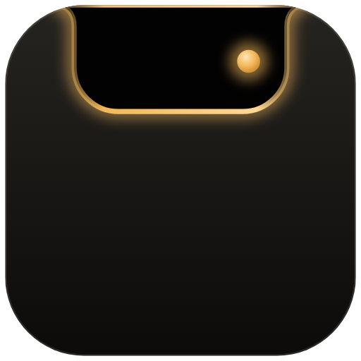

  

<h1 align="center">Islet</h1>

  Claude Code approvals, a focus timer, your calendar, clipboard and more, living in your MacBook's notch. 
  Free forever. No account, no tracking.

  <a href="https://tryislet.com"><b>Download at tryislet.com</b></a>

---

This repository is for **bug reports and ideas**. Islet's code isn't here.

- **Found a bug?** [Report it](../../issues/new?template=bug.yml). In Islet, *Settings → Report a bug* fills in your versions for you.
- **Have an idea?** [Suggest it](../../issues/new?template=idea.yml).
- **Before posting,** search the [open issues](../../issues) in case someone already has. A 👍 on an existing issue helps more than a duplicate.
- **Something private?** Email hello@tryislet.com.

### What's in the notch

| | |
|---|---|
| **Claude** | Approve, deny or reply to Claude Code sessions without switching windows |
| **Focus** | A focus timer that blocks distracting sites while it runs |
| **Calendar** | Your next meeting, with a camera check before you join |
| **Shelf** | Drop files on the notch to keep them close |
| **Clipboard** | The last things you copied, with pins |
| **Notes** | A scratchpad and to-do list |
| **Media** | What's playing in Spotify or Apple Music |
| **System** | CPU, memory, disk, network and temperatures |

Requires macOS 14 or later. Works best on a MacBook with a notch; other screens get a notch-shaped pill.

Islet is an independent app and isn't affiliated with Anthropic. Claude is a trademark of Anthropic.
